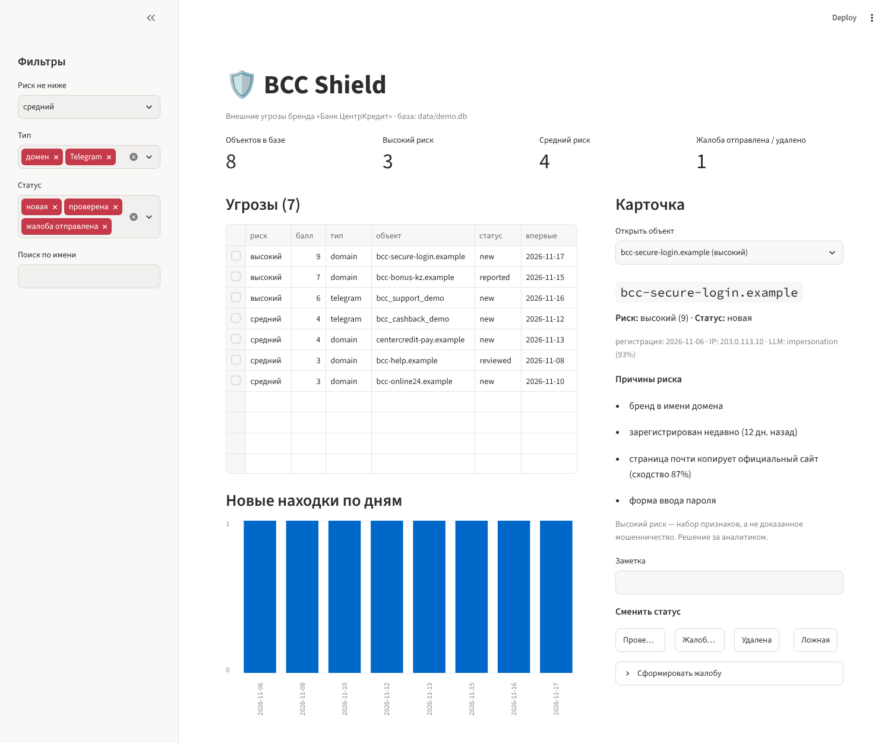

# 🛡️ BCC Shield — мониторинг фейков бренда банка вне его периметра

[](https://github.com/Nurrss/shield/actions/workflows/daily.yml)

> **Одной фразой:** каждое утро система сама находит двойников Банка ЦентрКредит — похожие домены и Telegram-аккаунты,
> объясняет, чем каждый опасен, присылает в Telegram только новое и готовит жалобу на удаление.

**Посмотреть за 1 минуту** (вымышленная демо-база, интернет и ключи не нужны):

```bash
pip install -r requirements.txt
python scripts/make_demo_db.py
SHIELD_DB=data/demo.db streamlit run dashboard.py
```

Проект для ITU Hackathon-2026, кейс «Инновации в банкинге и кибербезопасность» (Банк ЦентрКредит).

**Проблема.** Банк видит мошенничество, только когда клиент уже отдал деньги. А подготовка идёт снаружи:
фейковые сайты с похожими доменами, Telegram-боты «службы поддержки» с именем банка. У банка один официальный бот —
а похожих аккаунтов в Telegram десятки. Проверять это вручную каждый день невозможно, платные вендоры
(Group-IB, Kaspersky и др.) дороги и слабо знают казахстанскую специфику.

**Решение.** BCC Shield каждый день сам ищет двойников бренда и показывает службе безопасности, что нового,
что изменилось и что исчезло. Для каждой находки — оценка риска **с понятными причинами**, скриншот,
готовый текст жалобы на RU / KZ / EN и алерт в Telegram. Система не выносит приговоров: «высокий риск» — это набор
признаков, решение принимает аналитик.


<sub>Дашборд на вымышленных демо-данных (домены в зоне `.example`).</sub>

## Как это работает

```
~33 тыс. вариантов доменов        DNS → что реально существует (≈95)
(опечатки + бренд + слова + зоны)  RDAP → дата регистрации; HTTP → что на странице
331 имя в Telegram                 публичные карточки t.me → какие существуют (≈29)
            │
            ▼
   Оценка риска: сумма понятных признаков (веса в config.yaml)
            │
            ▼
   Глубокий анализ подозрительных доменов: скриншот → сходство с bcc.kz → вердикт LLM
   (отсеивает заглушки «домен продаётся», посторонние сайты, защитные редиректы банка)
            │
            ▼
   SQLite с историей → события: новый / риск вырос / изменился / исчез
            │
            ├─► алерт в Telegram-канал   python -m shield notify
            ├─► дашборд (Streamlit)       streamlit run dashboard.py
            ├─► жалоба в один клик        python -m shield takedown <объект> --lang kz
            └─► HTML-отчёт и CSV
```

Ежедневный запуск — GitHub Actions (`.github/workflows/daily.yml`).

### Признаки риска

| Признак | Балл |
|---|---|
| Бренд в имени домена | +3 |
| Опечатка официального домена в зоне .kz | +1 |
| Зарегистрирован меньше года назад | +3 (до 2 лет: +1) |
| Свежий SSL-сертификат (≤30 дней) | +2 |
| На странице упоминается банк | +3 |
| …и есть форма пароля / данных карты | +2 / +2 |
| Страница почти копирует сайт банка | +4 |
| Вердикт LLM: имитация / подозрительно | +4 / +2 |
| Посторонний контент без упоминания банка | −2 |
| Редирект на официальный сайт | защитная регистрация, не угроза |

Высокий риск — от 5 баллов, средний — от 3 (настраивается в `config.yaml`).

## Быстрый старт

```bash
python -m venv .venv && source .venv/bin/activate     # Windows: .venv\Scripts\activate
pip install -r requirements.txt
python -m playwright install chromium                  # браузер для скриншотов (один раз)
python -m pytest -q                                    # автотесты

# Посмотреть без реальных данных (вымышленная демо-база):
python scripts/make_demo_db.py
SHIELD_DB=data/demo.db streamlit run dashboard.py
SHIELD_DB=data/demo.db python -m shield notify --dry-run

# Настоящий прогон:
export GEMINI_API_KEY=...                              # ключ LLM; без него работает всё, кроме вердикта LLM
python -m shield run --limit 500                       # быстрая проба (~1 мин)
python -m shield run                                   # полный прогон (~15–25 мин)
python -m shield list                                  # угрозы среднего и высокого риска
python -m shield events --days 1                       # что нового за сутки
python -m shield stats                                 # цифры воронки
```

### Команды

| Команда | Что делает |
|---|---|
| `run` | собрать → оценить → проанализировать → сохранить |
| `analyze [--force]` | скриншот + LLM-вердикт для подозрительных доменов |
| `list`, `events`, `stats` | угрозы, изменения за период, цифры |
| `status <тип> <имя> <статус>` | отметить: reviewed / reported / removed / false_positive |
| `notify [--dry-run]` | новые события → Telegram-канал (`TELEGRAM_BOT_TOKEN`, `TELEGRAM_CHAT_ID`) |
| `takedown <объект> --lang ru\|kz\|en` | жалобы регистратору, хостеру, в Telegram, в KZ-CERT |
| `report`, `export` | HTML-отчёт со скриншотами, CSV |

Жалобы: адреса abuse регистратора и хостера берутся из RDAP, Telegram — `abuse@telegram.org` и бот `@NoToScam`,
KZ-CERT — `incident@cert.gov.kz`, телефон 1400. Подпись задаётся в `config.yaml` → `takedown.sender`.
Отправляет жалобы представитель банка или человек по его поручению: регистраторам и Telegram нужно подтверждение прав на бренд.

### Другой банк

Бренд, домены, зоны, корни имён и веса — в `config.yaml`. Чтобы защитить другой банк, достаточно поменять этот файл.

## Устройство кода

```
config.yaml            бренд, официальные домены/аккаунты, веса риска, LLM
dashboard.py           дашборд Streamlit
shield/
  collectors/          domains.py (dnstwist → DNS → RDAP → HTTP), certs.py (crt.sh), telegram.py (t.me)
  scoring.py           оценка риска: сумма объяснимых признаков
  analyze.py           скриншот (Playwright), сходство с официальным сайтом
  llm.py               вердикт LLM: Gemini / OpenAI / Anthropic через HTTP
  db.py                SQLite: assets, observations, events
  pipeline.py          один прогон
  notify.py            алерты в Telegram
  takedown.py          шаблоны жалоб RU/KZ/EN + поиск abuse-адресов в RDAP
  stats.py             цифры для презентации
  report.py            HTML-отчёт
tests/                 автотесты: оценка риска, анализ, алерты, жалобы
scripts/make_demo_db.py   демо-база с вымышленными данными
```

## Этика и безопасность

- Только публичные данные: DNS, RDAP, публичные страницы сайтов и t.me. Клиентских данных система не касается.
- Ботам и аккаунтам ничего не пишем и `/start` не нажимаем.
- Страницы открываются только в изолированном headless-браузере; вручную подозрительные сайты — через urlscan.io или ВМ.
- Ключи — только в переменных окружения и GitHub Secrets. Реальные находки в репозиторий не попадают (`data/` в `.gitignore`).
- Список находок передаётся банку как «требует проверки»; публично аккаунты мошенническими не называем.

## Ограничения (честно)

- «Высокий риск» — не доказательство. Часть сайтов отвечает только из Казахстана (геофильтр), их нужно проверять отдельно.
- Telegram-карточки публичны не для всех аккаунтов; закрытые чаты и личные сообщения система не видит.
- Охват: домены-двойники и Telegram. Соцсети, магазины приложений, SMS и звонки — следующий этап.
- Текст жалоб на казахском стоит показать носителю языка перед отправкой.
